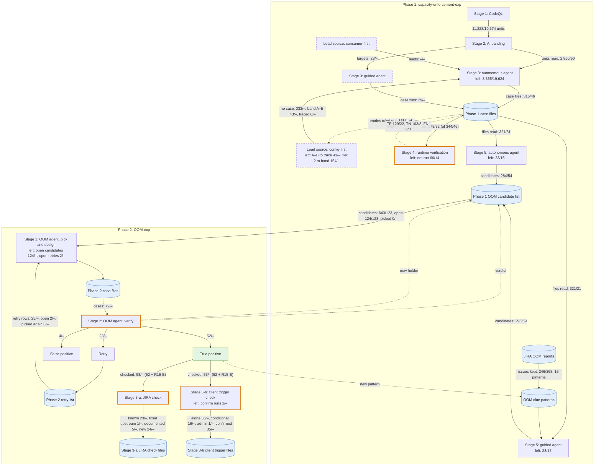

# Experiments — functionality and flowchart

*Written 2026-11-17; redesigned the same day (owner).* What `capacity-enforcement-exp` (phase 1) and
`OOM-exp` (phase 2) do and how they hand work to each other, with one flowchart. The method of each step
stays in the file each row points to; this page is the map. In prose: [`README.md`](README.md).

> **Rule ([`CLAUDE.md`](CLAUDE.md), 2026-11-17, widened 2026-11-23):** whenever a commit under `experiments/` changes
> the design (a step, agent, playbook, list, vocabulary or hand-off) **or a result number** of either experiment, update
> this page in the same commit: tables and chart plus a change-log line for design; arrow labels and §5.1 for numbers.

## 1. The two experiments

**Phase 1, [`capacity-enforcement-exp/`](capacity-enforcement-exp/README.md)** (Targets 1 + 2; Cassandra
5.0.9, Hadoop 3.4.2). It finds the **resource constraints** that are supposed to cap a node's memory or
disk and checks whether usage follows each one (stages 1–4), then reads every filed case for **clues that
could lead to OOM** and writes them as **OOM candidates** (stage 5). Stage 3 reads units from three **lead sources**
(2026-11-25): CodeQL (stages 1–2), **config-first** (every configuration entry no case covers yet) and
**consumer-first** (memory consumers, designed only).
[`entry-restriction-exp/`](entry-restriction-exp/README.md) is a paused phase-1 supplement.

**Phase 2, [`OOM-exp/`](OOM-exp/README.md)** (Target 3; Cassandra so far). An **OOM agent** picks
candidates (and earlier cases worth a retry), writes a case file with a design that should lead to OOM
(stage 1), then a fresh OOM-agent session runs that design and concludes **true positive**, **false
positive** or **retry** (stage 2). Every true positive is then checked read-only against Apache JIRA (stage 3-a) and
for whether an ordinary client could trigger it (stage 3-b).
Only default constraints are considered (rule 2026-11-23).

## 2. Phase 1 — functionality

| Step | What it does | Where |
|---|---|---|
| Stage 1 — CodeQL | Narrows `if` statements structurally to a worklist (no keyword list) | [`stage1-codeql-preprocessing/`](capacity-enforcement-exp/stage1-codeql-preprocessing/README.md) |
| Stage 2 — AI banding | Ranks rows A/B/C/D by name only; rules nothing out | [`stage2-ai-preprocessing/`](capacity-enforcement-exp/stage2-ai-preprocessing/README.md) |
| Lead source — config-first (2026-11-25) | Coverage diff of every configuration entry against the case files (script, no agents) → band the entries no case covers → stage-3 agent traces each forward from its declaration; case files carry `Lead source \| config-first` | [`source-config-first/`](capacity-enforcement-exp/source-config-first/README.md), `<sys>/source-config-first/config-coverage.csv` |
| Lead source — consumer-first (2026-11-25, designed) | Memory consumers as stage-3 units: data-sized allocation sites with no check on the path (CodeQL) and consumers that grow with a workload dimension (scaling profile); case files carry `Lead source \| consumer-first` | [`source-consumer-first/`](capacity-enforcement-exp/source-consumer-first/README.md) |
| Stage 3 — autonomous agent | Target only, isolated source copy: traces the constraint, estimates, designs unit + cluster tiers (a non-config variant skips config-type constraints) | [`playbook-autonomous.md`](capacity-enforcement-exp/stage3-ai-deep-read/playbook-autonomous.md), [`playbook-non-config-autonomous.md`](capacity-enforcement-exp/stage3-ai-deep-read/playbook-non-config-autonomous.md) |
| Stage 3 — guided agent | Target + the three rules, enforcement patterns, test-design method | [`playbook-guided.md`](capacity-enforcement-exp/stage3-ai-deep-read/playbook-guided.md) |
| Stage 3 — verdict files | `_INDEX.md`, `predicted-negative/positive.md`, `undetermined.md` | `capacity-enforcement-exp/<system>/stage3-ai-deep-read/` |
| Stage 4 — runtime verification | Design audit, frozen predictions, runs, verdict, outcome class (TP / FP / TN / FN / undetermined); feedback amends the case file | [`stage4-runtime-verification/`](capacity-enforcement-exp/stage4-runtime-verification/README.md) |
| JIRA OOM report | Per system: analysis of the project's JIRA OOM reports (cause patterns, by-design closures); read only | [`jira-mining.md`](capacity-enforcement-exp/stage5-oom-clue-find/jira-mining.md), `<system>/stage5-oom-clue-find/jira-oom-report.md` |
| OOM clue patterns | System-agnostic `CP-<n>` patterns from the JIRA reports and phase-2 true positives | [`oom-clue-patterns.md`](capacity-enforcement-exp/stage5-oom-clue-find/oom-clue-patterns.md) |
| Stage 5 — autonomous agent | Reads one case file (+ stage-4 results), finds clues in its own words; never sees patterns, JIRA or phase 2 | [stage-5 `playbook-autonomous.md`](capacity-enforcement-exp/stage5-oom-clue-find/playbook-autonomous.md) |
| Stage 5 — guided agent | The same, checking each OOM clue pattern | [stage-5 `playbook-guided.md`](capacity-enforcement-exp/stage5-oom-clue-find/playbook-guided.md) |
| Phase 1 OOM candidate list | One row per candidate (`OC-<n>`), agent, patterns, Status written back by phase 2; plus `coverage.csv` | `<system>/stage5-oom-clue-find/phase1-oom-candidates.md` |

## 3. Phase 2 — functionality

| Step | What it does | Where |
|---|---|---|
| Stage 1 — pick and design (OOM agent) | Picks from the candidate list and the retry list (JIRA prior-art check, skips recorded); writes the case file: the phase-1 case file, a frozen design solution, conclusion `pending` | [`oom-agent-playbook.md`](OOM-exp/oom-agent-playbook.md), [`_TEMPLATE-case.md`](OOM-exp/_TEMPLATE-case.md) |
| Technique notes | Convergence (custom / default), combo, bypass: shapes for a design | [`custom-convergence`](OOM-exp/custom-convergence-playbook.md), [`default-convergence`](OOM-exp/default-convergence-playbook.md), [`combo`](OOM-exp/combo-playbook.md), [`bypass`](OOM-exp/bypass-playbook.md) |
| Stage 2 — verify (fresh OOM agent) | Runs the frozen design, records harness and runs, adds the conclusion | oom-agent playbook, [`verification-protocol.md`](OOM-exp/verification-protocol.md) |
| Verdict | **true positive** (OOM, V1–V7 met) / **false positive** (a valid design cannot reach OOM, or OOM only with a non-default constraint) / **retry** | oom-agent playbook "False positive or retry" |
| Scope rule (2026-11-23) | Default constraints only: stage 1 skips a candidate that needs a non-default constraint; budgets follow V7; control/intervention arms may change one | [`verification-protocol.md`](OOM-exp/verification-protocol.md) "Default constraints only" |
| Stage 3-a — JIRA check (fresh session, 2026-11-23) | Each true positive checked read-only against Apache JIRA: match level, issue state, fix in the pinned version, documented source; one label per case | oom-agent playbook, `OOM-exp/<system>/stage3-jira-check/` |
| Stage 3-b — client trigger check (fresh session, 2026-11-23) | Each true positive checked against a client threat model (authenticated non-admin user, native protocol only): lowest privilege, conditions outside the client's control, blast radius; optional confirm runs | oom-agent playbook, `OOM-exp/<system>/stage3b-client-trigger/` |
| Phase 2 retry list | Cases worth another try, with what a better design should change | `OOM-exp/<system>/phase2-retry-list.md` |
| Case index | Every case with its verdict, phase-1 case file, stage 3-a JIRA label and stage 3-b client label | [`OOM-exp/cassandra/cases/_INDEX.md`](OOM-exp/cassandra/cases/_INDEX.md) |

## 4. Links between the experiments

| Link | Direction | Where |
|---|---|---|
| Stage 5 writes OOM candidates; the OOM agent picks from them | phase 1 → 2 | candidate list |
| Stage 2 writes each candidate's verdict back (per-agent true-positive rate) | phase 2 → 1 | candidate list Status |
| A true positive whose shape no pattern covers becomes a new clue pattern | phase 2 → 1 | `oom-clue-patterns.md` |
| A new holder a stage-2 run revealed but did not claim becomes a candidate row (owner-approved, Agent `phase-2 (<ID>)`) | phase 2 → 1 | candidate list |
| Each phase-2 case names its phase-1 case file | phase 2 → 1 | case file §1, `_INDEX.md` |

## 5. Flowchart

Each box holds the step name and, where work is left, a second line **left: …** (from the "+ left" terms of 5.1; never in-progress counts); what each step does is in sections 2–4. Arrow labels carry the **current numbers** as
**Cassandra/Hadoop** (for example `295/26`), as of 2026-11-25; **–** = not started for that system. The full breakdown
with sources is in 5.1. **Node markers** (open work, details in 5.2): **orange border** = work at this step waits on an
owner decision; **dashed border** = not started for Hadoop (phase 2 is Cassandra only and is not marked). Solid arrows: the main path. Dotted arrows:
write-back and feedback. Cylinders: lists and files that one step writes and another reads.

Notes on the chart:

- **Stage 5 never chases a clue** and phase-1 agents never read phase-2 results; the only phase-2 signal
  that reaches phase 1 is a new clue pattern, which only the guided agent reads.
- **Lead sources** (2026-11-25): config-first has run steps 1 (coverage diff) and 2 (banding of the 333 entries
  with no case) for Cassandra; its forward trace and the whole consumer-first source are not started.
- **Hadoop** has run phase 1 stages 1–3 (Jingsong's queue orders 1–45, Yang's first 5 rechecks), stage 4 on 32 of its 46
  case files (14 wait), its JIRA OOM report and stage 5 on 31 case files (Jingsong's orders 1–31; 123
  candidates);
  its guided stage-3 agent and phase 2 are not started.

### 5.1 Results snapshot (as of 2026-11-25)

Each step is written as **in = out + … + left**, Cassandra and Hadoop separately, and every sum closes. Counts are
recomputed from the data files named (where a README or handoff states an older count, the data file wins); refreshed
in the same commit as any result change (rule in [`CLAUDE.md`](CLAUDE.md)). Paths are under
`capacity-enforcement-exp/` unless they start with `OOM-exp/` or `codeql-queries/`.

#### Phase 1 — `capacity-enforcement-exp`

**Stage 1, CodeQL: result rows → units** (`codeql-queries/results/<sys>/`, gitignored; unit ids from
`codeql-queries/scripts/make-stage2-batches.py`). Narrowed rows are one unit each; helper-guarded rows collapse to one
unit per helper; enforcement rows to one per comparison/call key, verdict rows to one per verdict method; capacity-set
rows are one unit each.

| Query | Cassandra rows → units | Hadoop rows → units |
|---|---|---|
| NarrowedIfStatements | 4,489 → 4,489 | 9,269 → 9,269 |
| HelperGuardedIfStatements | 1,099 → 300 | 1,573 → 415 |
| EnforcementPlaces, comparison or call | 4,212 → 3,482 | 4,481 → 3,677 |
| EnforcementPlaces, verdict | 1,340 → 465 | 2,251 → 1,194 |
| CapacitySetPlaces | 2,492 → 2,492 | 5,119 → 5,119 |
| **Total** (`if` corpus + extension) | **13,632 → 11,228** (4,789 + 6,439) | **22,693 → 19,674** (9,684 + 9,990) |

**Stage 2, banding** (`<sys>/stage2-ai-preprocessing/bands.csv`): units = A + B + C + D.

| | A | B | C | D | Units |
|---|---|---|---|---|---|
| Cassandra `if` corpus / extension | 134 / 90 | 174 / 124 | 94 / 307 | 4,387 / 5,918 | 4,789 / 6,439 |
| **Cassandra** | 224 | 298 | 401 | 10,305 | **11,228** |
| Hadoop `if` corpus / extension | 90 / 110 | 170 / 272 | 489 / 615 | 8,935 / 8,993 | 9,684 / 9,990 |
| **Hadoop** | 200 | 442 | 1,104 | 17,928 | **19,674** |

**Lead source, config-first** (`cassandra/source-config-first/config-coverage.csv`; Hadoop not started).

- **Cassandra: entries 735 = in scope 645 + out of scope 90** (JVM properties for tests, the JDK, logging, JMX); in scope
  645 = yaml 409 + JVM 236.
  - 645 = constraint of a case 158 + mentioned in a case only 154 + a stage-1 unit names it 14 + a stage-1 unit near a
    read 201 + read, no unit near 100 + not read in `src/java` 18;
  - no case at all 333 (tiers 3–6) = name-hinted 98 + other 235;
  - banded 333 (`config-bands.csv`, 2026-11-26) = A 4 + B 39 + C 93 + D 197; anchor check passed in 4 of 4 batches;
  - A–B 43 = traced 0 + left 43; tier 2's 154 = banded 0 + left 154.
- **Consumer-first:** not started for either system.

**Stage 3, deep read — units** (Cassandra: `cassandra/stage3-ai-deep-read/` set CSVs, band-D progress CSVs,
`band-d-noncfg-processed.md`; Hadoop: `hadoop/status.py`, the two `queue.csv`).

- **Cassandra: 11,228 = read 2,860 + already a case target, not re-read 13 + queued, not read 2,437 + not queued 5,918.**
  - read 2,860 = `if` A–C 402 (pre-existing targets 65, set A 168, set B 169) + band-D set B 2,193 + band-D set A helpers
    30 + extension orders 1–239 except the existing cases at 75, 149, 153 and 190 (235 rows);
  - read 2,860 = became a case target **393** (65 + 163 + 27 + 88 + 50) + judged not a case **2,467** (set A config-type skips
    5, set B judged without write-up 169, band-D helpers 3, band-D set B refused 2,105, extension covered 185);
  - extension 235 = band A batch 1 (orders 1–53: 10 written up + 43 covered) + batch 1 of 2026-11-24 (orders 54–134 less
    75: 20 written up + 60 covered) + batch 2 of 2026-11-24 (orders 135–239 less 149, 153, 190: 20 written up + 82 covered);
  - not re-read 13 = 6 extension anchors (not in `writeup-set-ext.csv`) + 7 extension rows already a case target;
  - queued, not read 2,437 = band-D set A 2,164 + extension band C 273 (orders 240 on); not queued = extension band D 5,918.
- **Hadoop: 19,674 = read 50 + queued, not read 10,631 (Yang 8,930, Jingsong 1,701) + not queued 8,993** (extension band D).
  Read 50 = became a case 46 (Yang 1, Jingsong 45: queue orders 1–45) + not a case 4 (Yang's rechecks that stayed in band D).

**Stage 3 — case files** (`<sys>/stage3-ai-deep-read/_INDEX.md` §1; §2's "58" is stale).

| Cassandra source | Files | Guided | Positive / negative / undetermined |
|---|---|---|---|
| Before the two-set job (2026-10-22) | 58 | 29 | 42 / 16 / 0 |
| Set A, autonomous write-ups | 125 | 0 | 22 / 103 / 0 |
| Set A, non-config agent | 27 | 0 | 13 / 14 / 0 |
| Band-D set A helpers, non-config job | 27 | 0 | 0 / 27 / 0 |
| Band-D set B, advisor run | 57 | 0 | 50 / 0 / 7 |
| Extension, band A batch 1 | 10 | 0 | 10 / 0 / 0 |
| Extension, batch 1 of 2026-11-24 (orders 54–134) | 20 | 0 | 13 / 7 / 0 |
| Extension, batch 2 of 2026-11-24 (orders 135–239) | 20 | 0 | 9 / 11 / 0 |
| **Total** | **344** (autonomous 315 + guided 29) | **29** | **159 / 178 / 7** |

Hadoop: **46** case files = autonomous 46 = positive 36 + negative 10 (Yang 1 negative; Jingsong 45 = batch of 2026-11-06
3 + 2, batch 1 of 2026-11-24 (orders 6–25) 15 + 5, batch 2 of 2026-11-24 (orders 26–45) 18 + 2).

**Stage 4, runtime verification** (`_INDEX.md` outcome column, `stage4-runtime-verification/results/`).

- **Cassandra: 344 = run 278 + not run 66.**
  - run 278 = TP 129 + FP 0 + TN 103 + FN 6 + undetermined 18 + weak 22 (TP 9, TN 12, FN 1);
  - not run 66 = `none`-type cases awaiting the owner's decision 29 + cases with a constraint type but no stage-4 run
    recorded 14 + waiting 23 (extension batch 1 of 2026-11-24 3: 57, 64 and 70 returned no result from the deferred run;
    17 of its 20 finished, 116 and 125 on 2026-11-25 in chunk 1; extension batch 2 of 2026-11-24 20); the 23 are running
    in the 2026-11-25 node session.
- **Hadoop: 46 = run 32 + waiting 14**; run 32 = TP 22 + TN 8 + undetermined 1 + weak 1 (TP 1); waiting 14 = Jingsong's
  batch 2 of 2026-11-24 orders 32–45 (running in the 2026-11-25 node session); Jingsong's batch 1 of 2026-11-24 (orders
  6–25) all 20 finished, orders 26–31 of batch 2 finished (chunk 1 of 2026-11-25: 6, 14, 22, 26–31).

**JIRA OOM report** (`<sys>/stage5-oom-clue-find/jira-oom-survey.csv`).

- **Cassandra: 604 = kept 246 + excluded 358**; kept 246 = Fixed 120 + open 45 + by design or invalid 45 + duplicate or
  cannot reproduce 36.
- **Hadoop: 961 = kept 368 + excluded 593**; kept 368 = Fixed 201 + unresolved 97 + by design or invalid 35 + duplicate or
  cannot reproduce 35.

**OOM clue patterns** (`stage5-oom-clue-find/oom-clue-patterns.md`): **16** = from Cassandra's report only 13 (CP-1–7,
9–14) + from Hadoop's only 2 (CP-15, CP-16) + from both 1 (CP-8) + added by phase 2 0.

**Stage 5, clue find** (`<sys>/stage5-oom-clue-find/coverage.csv`, `phase1-oom-candidates.md`).

- **Cassandra:** case files read 321 of 344 by each agent (coverage.csv has 643 rows = 321 + 321 + 1 placeholder row; the
  23 waiting for stage 4 are not read yet); files with at least one candidate: autonomous 197, guided 212.
- **Candidates 643** (OC-1–643), agent × Status:

| Agent \ Status | Open | Picked (phase-2 stage 1) | True positive | Covered | Retry | Skipped | Total |
|---|---|---|---|---|---|---|---|
| Autonomous | 48 | 0 | 42 | 124 | 0 | 70 | 284 |
| Guided | 59 | 0 | 29 | 121 | 1 | 85 | 295 |
| Legacy (migrated lists) | 17 | 0 | 27 | 5 | 1 | 12 | 62 |
| Phase-2 | 0 | 0 | 1 | 0 | 1 | 0 | 2 |
| **Total** | **124** | **0** | **99** | **250** | **3** | **167** | **643** |

  Covered 250 = by a true positive 216 + by a retry later re-tested as a true positive 16 (B14 → R13 7, B18 → R21 4,
  B11 → R12 2, U6 → R15 2, U5 → R14 1) + by a retry still retry 9 (B7 6, R8 3) + by a false positive 9 (B1 6, C3 3).
  Skipped 167 (triage lists of 2026-11-18 and 2026-11-20 closed, 2026-11-24) = needs a non-default constraint 82 + disk-only
  or too slow 33 + duplicate of a case 31 + needs corrupt input 9 + overshoot of one item already capped 6 + small 4 + a
  caveat, not a memory mechanism 2. Wave 7 wrote back the 23 picked rows: true positive 22 (B27 12, B25 2, B26 2, B29 2,
  R24 2, B28 1, U17 1) + retry 1 (U16, OC-578); OC-479 moved from retry (B22) to true positive (R24); OC-5 stays true
  positive (B8; R23). Retry 3 = OC-2 (B7), OC-140 (U6), OC-578 (U16).
- **Hadoop:** case files read 31 of 46 by each agent (Jingsong's orders 1–31; coverage.csv has 62 rows);
  not read 15 = waiting for stage 4 14 + Yang's 1 of 2026-11-06; files with at least one candidate: autonomous 25, guided 26.
  **Candidates 123** (`hadoop:OC-1`–`OC-123`) = autonomous 54 + guided 69, all open.

#### Phase 2 — `OOM-exp` (Cassandra; Hadoop not started)

**Inputs:** candidates 643 (open 124, picked 0, above). **Retry list** (`OOM-exp/cassandra/phase2-retry-list.md`): **25
rows = closed 23 + picked again 0 + open 2** (U16, R25, both 2026-11-24). Closed 23 = re-tried → true positive 9 (+ B22 →
R24) + a true positive re-opened → true positive 1 (B8 → R23) + re-tried → retry again 7 (+ R19 → R25) + re-tried → split
(U6 → R15) 1 + covered by the default re-tests (R2–R4) 3 + C3 false positive 1 + disk-paused skip 1.

**Stages 1–2, verdicts** (`OOM-exp/cassandra/cases/_INDEX.md`; verdicts matched with and without bold).

- **Case files 79 = verified 79 + at stage 1 0.** Wave 7 (the owner-approved batch of 2026-11-24, filed 2026-11-25) gave
  all 10 a verdict: from the candidate list 7 (B25, B26, B27, B28, B29, U17 true positive; U16 retry) + from the retry
  list 3 (R23, R24 true positive; R25 retry).
- **Index rows 84 = history rows 5 + cases 79.** History → successor: R1 → R1-V, R6 → R6-V, C1 run 3 / reopen /
  multiplicity → C1 run 4.
- **Verified cases 79 = true positive 52 + false positive 4 + retry 23** (R15 counted as retry: its condition A is a retry, its
  condition B a true positive).
  - true positive 52 = `deployment` 50 + `diagnostic` 2 (C1, B8); R23's `deployment` is proposed, pending the owner's
    review of the archive restore and the slow data volume as an external fault;
  - false positive 4 = R6-V, C3, R9, B1;
  - retry 23 = re-tried → true positive 9 (U1 → R7, B11 → R12, B14 → R13, U5 → R14, R10 → R18, R16 → R21, R15-A → R20,
    R17 → R22, B22 → R24) + re-tried → retry again 7 (B7 → R8, R5 → R10, R8 → R11, B18 → R16, U11 → R17, R11 → R19,
    R19 → R25) + re-tried → split 1 (U6 → R15) + covered by the default re-tests 3 (R2–R4) + disk-paused skip 1 + **open,
    not yet re-tried 2** (U16, R25).

**Stage 3-a, JIRA check** (`OOM-exp/cassandra/stage3-jira-check/`).

- **Checked 53 = true positives 52 + R15-B** (R15's condition B; R15 counts as a retry). 30 on 2026-11-23 + 15 on
  2026-11-24 (B9, B10, B12, B13, B15, C4–C8, U2–U4, R7, R15-B; missed on 2026-11-23 by a counting error) + wave 7's 8
  (R23, R24, U17, B25–B29).
- **Checked 53 = known-open 12 + known-fixed (not in 5.0.9) 5 (U10, B20, R21, U2, U4) + known-fixed (incomplete) 7 (B8, R14,
  B10, B15, C7, R23, R24) + documented only 5 (R1-V, R18, U12, C4, U3) + new 24.** Mentioned in JIRA (exact or partial match)
  = 23 (exact 11 + partial 12); not mentioned but fixed incidentally 1 (R21). Chart: known 23 + fixed upstream 1 +
  documented 5 + new 24.

**Stage 3-b, client trigger** (`OOM-exp/cassandra/stage3b-client-trigger/`).

- **Checked 53** (as 3-a: 30 on 2026-11-23, 15 + wave 7's 8 on 2026-11-24).
- **Checked 53 = user alone 36 + given an outside condition 16 + admin only 1** (R18).
  - alone 36 = pre-auth 4 (B19, U2, B9, B13) + login role without grants 6 (R13, R20, R15-B, B12, U17, B28) + data role 19 +
    DDL role 7 (C9, U8, B20, U14, C4, C6, C8);
  - outside condition 16 = a node or replica event 7 (B23, B6, B8, B15, C5, R23, B29) + a small node or an operator memory
    budget below the resolved one 5 (C1, S1, U13, R1-V, R7) + an operator-run repair 1 (C7) + an operator-run profileload 2
    (B25, B26) + no other traffic on the coordinator 1 (R24).
- **Confirm runs: 53 = run 39 + not run 14; run 39 = confirmed 35 + partly 4** (R13, U7, U14, R24); run 39 = 23 on
  2026-11-23 + 16 on 2026-11-24 (B9, B10, B12, B13, C4, C6, C8, U2, U3, U4, R15-B; R24, U17, B27, B28, B29); not run 14 =
  judged low value on 2026-11-23 7 + not worthwhile 6 (B15, C5, C7, R7, R23, B25) + recommended, not run 1 (B26).

### 5.2 Open work (as of 2026-11-25)

What is left at each step, from the "+ left" terms of 5.1 and the open items in the handoffs. Numbers are
**Cassandra/Hadoop** where both apply. **Waiting on**: **owner** = a decision only the owner can make (orange border in
the chart); **queue** = ordinary work for whoever runs that queue; **node** = a broken node or environment. Refreshed with
5.1 (rule in [`CLAUDE.md`](CLAUDE.md)).

**Phase 1 — `capacity-enforcement-exp`**

| Step | What is left | Waiting on | Tracked in |
|---|---|---|---|
| Stage 1 — CodeQL | nothing; optional: numeric `switch` case labels are not matched | — | `stage1-codeql-preprocessing/README.md` |
| Stage 2 — banding | nothing | — | `bands.csv` |
| Lead source — config-first | Cassandra: forward-trace the **43** A–B entries (first batch 10, approved 2026-11-26); band tier 2's **154**; Hadoop: step 1 (coverage diff over `*-default.xml`) after its current stage-4 runs | **queue** | `source-config-first/README.md`, `<sys>/source-config-first/` |
| Lead source — consumer-first | everything: part A (CodeQL allocation-site query) and part B (scaling profile on a node), Cassandra first; its no-constraint cases depend on the `none`-type stage-4 design | **owner**: start it; the `none`-type design | `source-consumer-first/README.md` |
| Stage 3 — deep read | queued, not read **2,437/10,631** (C: band-D set A 2,164, extension band C 273 from order 240; H: Yang 8,930, Jingsong 1,701 from order 46); not queued **5,918/8,993** (extension band D); judged but not written up 169/– (set B); unresolved unit 1/–; notes backlog (stage-3 notes not applied to filed cases, `undetermined.md` §2 re-audit, `predicted-negative.md` §10 band-D lines); filer's calls of 2026-11-24 open to overrule (Cassandra extension: orders 100, 125 counted new, 70 and 122 typed `not-a-case`, builder/JMX arguments typed `query parameter`; batch 2: 207 (one verdict per place, P2 negative) counted positive, 145 typed `not-a-case`, 236–239 `scaling_parameters` typed `mixed ×2`) | **queue** (Jingsong: band-D set A, extension, Hadoop queue; Yang: set B write-ups, Hadoop queue); **owner**: whether to queue extension band D; the 2026-11-24 filer's calls | set CSVs, `hadoop/<name>/queue.csv`, `HANDOFF.md` "Open follow-ups", `HANDOFF-Jingsong.md` 2026-11-24 |
| Stage 4 — runtime verification | not run **66/14**: C 29 `none`-type + 14 with no run recorded + **23 waiting** (extension batch 1 of 2026-11-24 3: 57, 64, 70, which returned no result in the deferred run; batch 2 of 2026-11-24 20), H **14 waiting** (Jingsong's orders 32–45); all 37 are running in the 2026-11-25 node session (chunk 1 filed: C 116, 125; H 6, 14, 22, 26–31); 57 carries dated audit amendments of the interrupted 2026-11-24 run; undetermined **18/1** (rerun list in the handoff; C 133 added 2026-11-25: each tier missed one frozen control threshold; C 116 added 2026-11-25: unit Partly confirmed — caps, cluster Not confirmed); owner's calls: H 10's effect (filed `does not cap`, could read `caps only on some paths`, which would make it a false negative); H 14 (filed true positive under B3f's noise allowance; strict reading weak true positive); C 116 (weak true positive if the unit tier's Partly confirmed settles the effect, true positive if the 0.16 MiB heap miss is also accepted); C 115's cluster band miss | **owner**: the `none`-type design (29 cases); the H 10, H 14, C 115, C 116 calls; **queue**: the 37 waiting cases (in progress, 2026-11-25 node session), reruns | `_INDEX.md` §1 (both systems), `HANDOFF-Jingsong.md` 2026-11-24 and 2026-11-25, `HANDOFF.md` |
| JIRA OOM report | nothing | — | `jira-oom-report.md` |
| OOM clue patterns | nothing | — | `oom-clue-patterns.md` |
| Stage 5 — clue find | case files not yet read **23/15** (C: the 23 waiting for stage 4; H: the 14 waiting + Yang's 1 of 2026-11-06) | **queue** (after stage 4 for the waiting cases) | `coverage.csv` |
| Candidate list | open **124/123**; picked, at phase-2 stage 1 0/– (wave 7 wrote back all 23 on 2026-11-25); the 2026-11-18 / 2026-11-20 triage lists and B18's rows are closed (2026-11-24) | **queue** (OOM agent picks) | `phase1-oom-candidates.md` |

**Phase 2 — `OOM-exp`** (Cassandra; Hadoop not started)

| Step | What is left | Waiting on | Tracked in |
|---|---|---|---|
| Stages 1–2 — design, verify | cases at stage 1 or 2 **0** (wave 7 filed 2026-11-25: 8 true positive, 2 retry); open retries **2** (U16: a control that stays abort-free, or an owner ruling that the intervention arm serves as the matched control; R25: fixed rate and total from its diagnostics, smoothness judged on sends); owner rulings **6** (B19 T2's form, B21 failed I-2G intervention, U13 deployment vs diagnostic, U15 "not corrupt input", B15 proposed status, R23 proposed `deployment` with the archive restore and the slow data volume as an external fault); optional follow-ups 4 (R21 unclaimed lead, R22 512 MiB service-loss arm, R20 2 GiB matched set, B6 status caveat) | **owner**: the 6 rulings, U16's control ruling, a new batch; **queue**: the 2 retries, follow-ups | `cassandra/phase2-retry-list.md`, `cases/_INDEX.md`, `HANDOFF.md` waves |
| Stage 3-a — JIRA check | true positives not checked **0**; not ruled: C9, R1-V labels (as filed); flagged for the owner on 2026-11-24: B10 (`new` if CASSANDRA-20052 is rated related), C7 (by design or known-open), C8 (CASSANDRA-20752 borderline partial); flagged from wave 7: R24 (`new` if CASSANDRA-15907 is rated related), B27 (known-open via 21091), B28 (known-open via 13157), B29 (by design via 19018, or known-fixed (incomplete) via 15907); U4 and R14 ruled 2026-11-24 (an opt-in fix counts) | **owner**: the 7 flags; **queue** | `stage3-jira-check/README.md` |
| Stage 3-b — client trigger | true positives not analysed **0**; confirm runs not run: B26 (recommended, cheap: its login-role path is code reading only); confirm: U14 one more run (OOM 1 of 2), R24's victim effect (why 20 ops/s of other traffic prevents the OOM), repetition across nodes (all cases), B21 ring-wide fan-out, B20/U14 cluster-wide reach, B28 multi-node `system_traces` path, B27 `system_traces` no-grants path, B29 rolling restart; 7 cases of 2026-11-23 and 6 others not confirm-run (low value or outside condition decides) | **owner**: approve B26's confirm run; **queue** | `stage3b-client-trigger/README.md` |
| Nodes (both experiments) | stale locks and orphaned runs from the 02:30 interrupt were cleared on 2026-11-24 at 09:15 (owner); stale locks from the 15:00 stop were cleared at 15:00; wave 7 left every node unlocked with no processes, small logs under `/mydata/s4/<case>` and `/mydata/s4/3b-<ID>`; larger leftovers: pc82 `/mydata/s4/b27` (≈ 49 GB, 10 hprofs, B27 attempt 1, deletable), pc91 `/mydata/s4/b26` 1.3 GB, pc82 `/mydata/s4/r24` ≈ 0.9 GB, pc72 `/mydata/s4/3b-R24` 693 MB, pc91 `/mydata/s4/b27` 508 MB; **2026-11-25:** `pc99`'s stale lock (`jingsong-o70-stage4`) is gone; the phase-1 stage-4 runs (deferred run and chunk 1) left small logs in `/mydata/jingsong-cass-s4/o<order>` and `/mydata/jingsong-s4/<stem>-run1` on `pc72`, `pc75`, `pc82`, `pc91`, `ms0625`, `ms0640`; the 2026-11-25 node session runs the remaining phase-1 stage-4 cases | **owner**: delete wave-7 node data | `HANDOFF.md`, `HANDOFF-Jingsong.md` 2026-11-25 |

## 6. Change log of this page

| Date | Change |
|---|---|
| 2026-11-17 | Written: both experiments, linking functionality through the 2026-11-17 rulings (agent queues rows, autonomous OOM leads, recheck sweep, back-link updates the guided agent, lead-list status, rescan claims) |
| 2026-11-17 | Flowchart reduced to step names; descriptions stay in sections 2–4 (owner) |
| 2026-11-17 | **Redesign (owner):** the 2026-11-16/17 linking machinery and phase 2's lead sources removed; phase 1 gains stage 5 (OOM clue find: JIRA OOM reports → clue patterns; autonomous and guided agents → candidate list); phase 2 becomes the OOM agent's two stages with true positive / false positive / retry and a retry list; data-flow tracing dropped |
| 2026-11-18 | Candidate list status vocabulary gains `closed: covered by <case ID> (<verdict>)` (owner); no step or arrow changed |
| 2026-11-20 | New lead source (owner): stage 2 may propose a holder its runs revealed but did not claim; with approval it becomes a candidate row with Agent `phase-2 (<case ID>)` (first: OC-578 from R12). §4 row and a dotted `new holder` arrow O2 → CL added |
| 2026-11-23 | Phase 2 gains **stage 3, JIRA check** (owner): every true positive checked read-only against Apache JIRA; new chart nodes O3 and JC; case index gains a JIRA column. Scope rule (owner): default constraints only, an OOM needing a non-default constraint is a false positive and stage 1 skips such candidates (verdict row and new scope row) |
| 2026-11-23 | Stage 3 split (owner): the JIRA check becomes **3-a**; new **3-b, client trigger check** (could an ordinary authenticated user trigger the OOM and affect other users); chart nodes O3B and CT; case index gains a Client column |
| 2026-11-23 | Stage 3-b privilege levels gain `login role, no grants` (between pre-auth and data role), from the confirm runs; no step or arrow changed |
| 2026-11-23 | Result numbers added (owner): arrow labels in the chart and a results snapshot (5.1) for both phases, refreshed with each batch's results; Hadoop note corrected (its JIRA report exists, stage 5 not started) |
| 2026-11-23 | Arrow-label format (owner): numbers written as Cassandra/Hadoop with a legend, – = not started; phase-2 counts corrected (44 true positives, not 30; stage 3 covered 30 of them) |
| 2026-11-23 | Rule widened (owner): result-number changes in either experiment also update this page in the same commit; pointers added to the root `CLAUDE.md` batch-commit step and Hadoop `PROCEDURE.md` |
| 2026-11-23 | §5.1 rewritten as splits that close (owner): each step as in = out + … + left, per system; corrections: phase-2 cases 69, open retries 2, Cassandra units read 2,678, pattern origins 13 + 2 + 1 |
| 2026-11-24 | Open work shown (owner): new §5.2 (what is left per step, waiting on owner / queue / node) and node markers in the chart (orange border = waits on an owner decision; dashed = not started for Hadoop) |
| 2026-11-24 | Chart boxes show what is left (owner): step name plus a second line `left: …` (Cassandra/Hadoop) from the 5.1 "+ left" terms; ` ` is the only markup allowed in labels; §5.2 node and U4 rows brought up to date |
| 2026-11-25 | Two **lead sources** for stage 3 (owner): **config-first** (coverage diff of every configuration entry → banding → forward trace; Cassandra step 1 done) and **consumer-first** (allocation-site query + scaling profile; designed). Both write ordinary case files with a `Lead source` header row; new chart nodes LSC, LSU, arrows into stage 3 and a dotted CF → LSC; §2, §5.1, §5.2 rows |
