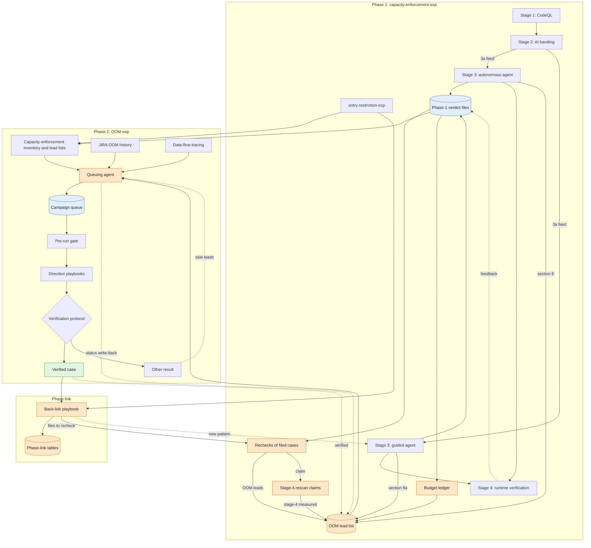

# Experiments — functionality and flowchart

*Written 2026-11-17.* What `capacity-enforcement-exp` (phase 1) and `OOM-exp` (phase 2) do, which parts
were added to link the two (from 2026-11-16), and one flowchart of the whole loop. The method of each
step stays in the file each row points to; this page is the map. How the phases relate in prose:
[`README.md`](README.md).

> **Rule ([`CLAUDE.md`](CLAUDE.md), 2026-11-17):** whenever a change under `experiments/` adds, removes,
> renames or reroutes a step, an agent, a playbook, a list or a hand-off between experiments, update this
> page (tables and flowchart) in the same commit, and add a line to the change log at the end.

## 1. The two experiments in one paragraph each

**Phase 1, [`capacity-enforcement-exp/`](capacity-enforcement-exp/README.md)** (Targets 1 + 2; Cassandra
5.0.9, Hadoop 3.4.2). It finds the **resource constraints** (config entries, JVM properties, constants,
runtime-queried limits) that are supposed to cap a node's memory or disk, and checks whether usage really
follows each one. Four stages, numbered by evidence strength: CodeQL narrows ~17k `if` statements (1), an AI
ranks the rows by name only (2), an autonomous and a guided agent read the source and write a case file
with an estimate and a two-tier test design (3), and stage 4 runs the design on real nodes and classes the
case (TP / FP / TN / FN / undetermined). [`entry-restriction-exp/`](entry-restriction-exp/README.md) is a
paused phase-1 supplement that works forward from where a constraint is declared.

**Phase 2, [`OOM-exp/`](OOM-exp/README.md)** (Target 3; Cassandra so far). Starting from phase 1's
constraints **at their defaults**, it asks whether a reachable workload with an acceptable memory budget
drives a node out of memory. Leads come from phase 1, JIRA history and data-flow tracing; a queuing agent
turns a lead into a campaign row; a direction playbook (convergence, combo, bypass, unprotected
accumulation) designs and runs it; the verification protocol (V1–V7) decides whether the result is
`verified-OOM` / `verified-gap`, `reproduced-*`, `candidate` or `negative`.

## 2. Phase 1 — functionality

| Step | What it does | Where |
|---|---|---|
| Stage 1 — CodeQL | Narrows `if` statements structurally to a worklist (no keyword list) | [`stage1-codeql-preprocessing/`](capacity-enforcement-exp/stage1-codeql-preprocessing/README.md) |
| Stage 2 — AI banding | Ranks rows A/B/C/D by name only; rules nothing out | [`stage2-ai-preprocessing/`](capacity-enforcement-exp/stage2-ai-preprocessing/README.md) |
| Stage 3 — feeds | 3a from the bands (countable), 3b from the raw source (insurance against stage 1's blind spot) | [stage-3 README](capacity-enforcement-exp/stage3-ai-deep-read/README.md) |
| Stage 3 — autonomous agent | Target only, isolated source copy: traces the constraint, estimates, designs unit + cluster tiers. Non-config variant skips config-type constraints | [`playbook-autonomous.md`](capacity-enforcement-exp/stage3-ai-deep-read/playbook-autonomous.md), [`playbook-non-config-autonomous.md`](capacity-enforcement-exp/stage3-ai-deep-read/playbook-non-config-autonomous.md) |
| Stage 3 — guided agent | Target + the three rules, enforcement patterns, test-design method | [`playbook-guided.md`](capacity-enforcement-exp/stage3-ai-deep-read/playbook-guided.md) |
| Stage 3 — verdict files | `_INDEX.md`, `predicted-negative/positive.md`, `undetermined.md`, band-D notes | `capacity-enforcement-exp/<system>/stage3-ai-deep-read/` |
| Stage 4 — runtime verification | Design audit, frozen predictions, run 1 (+ optional run 2), verdict, outcome class; feedback amends the case file | [`stage4-runtime-verification/`](capacity-enforcement-exp/stage4-runtime-verification/README.md) |

## 3. Phase 2 — functionality

| Step | What it does | Where |
|---|---|---|
| Lead sources | Capacity-enforcement inventory (phase-1 cases, stage-4 results, the OOM lead list); JIRA OOM history (read only: selection clues, prior art, positive controls); data-flow tracing (phase-2-only, finds memory no constraint touches) | [OOM-exp README "Lead sources"](OOM-exp/README.md#lead-sources) |
| Lead lists | N leads from phase-1 bypass notes; S patterns and L leads from cases and JIRA | [`phase1-bypass-leads.md`](OOM-exp/phase1-bypass-leads.md), [`pattern-leads.md`](OOM-exp/pattern-leads.md) |
| Queuing agent | Screens a lead, JIRA prior-art check, held ÷ counted evidence, ceiling check, ID + P1–P3, writes the campaign row and the lead's status back | [`queuing-playbook.md`](OOM-exp/queuing-playbook.md) |
| Campaign queue | C (convergence), B (bypass), U (unprotected accumulation), S (stacked combo), R (recheck of an earlier result) rows | [`cassandra/campaign-plan.md`](OOM-exp/cassandra/campaign-plan.md) |
| Pre-run gate | Protection map, configuration and budget audit, dated design, V7 budget, node preflight | queuing playbook §6, [`verification-protocol.md`](OOM-exp/verification-protocol.md) |
| Direction playbooks | Convergence (custom / default), combo (multiplicity → stack → accounting gap), bypass | [`custom-convergence`](OOM-exp/custom-convergence-playbook.md), [`default-convergence`](OOM-exp/default-convergence-playbook.md), [`combo`](OOM-exp/combo-playbook.md), [`bypass`](OOM-exp/bypass-playbook.md) |
| Verification | V1–V7 promotion rule; statuses with `deployment` / `diagnostic`; case index and run log | [`verification-protocol.md`](OOM-exp/verification-protocol.md), [`cassandra/cases/_INDEX.md`](OOM-exp/cassandra/cases/_INDEX.md) |

## 4. Added to link the two experiments (2026-11-16 on)

| Added | Functionality | Direction | Where |
|---|---|---|---|
| 2026-11-10/12 | JIRA and data-flow lead sources; N leads harvested from phase-1 bypass notes | 1 → 2 | OOM-exp README, `phase1-bypass-leads.md` |
| 2026-11-16 | **Phase model**: phase 1 / phase 2 per system, shared vocabulary | both | [`README.md`](README.md) |
| 2026-11-16 | **Guided OOM-lead patterns** E1–E4 (named 2026-11-17: counter ≠ real usage; direct error at the limit; per-owner limit × unbounded owners; defaults over-commit a shared budget), answered in each guided case's §8a with a **Real-memory estimate** | 2 → 1 (learned), 1 → 2 (leads) | guided playbook §3.2, `_TEMPLATE-guided.md` §8a, §10 |
| 2026-11-16 | **Rechecks of filed cases**: `blind` (no OOM-exp access, `recheck-blind.md`) and `back-link` modes; append-only sections | 1 → 2 | guided playbook §5 |
| 2026-11-16 | **Budget ledger**: per memory domain, the sum of every constraint's default at reference deployments (E4 across cases) | 1 → 2 | `cassandra/stage3-ai-deep-read/budget-ledger.md` |
| 2026-11-16 | **Back-link playbook** and **link tables**: each verified OOM case → was the clue in phase 1 (`flagged` / `recorded-untested` / `missed` / `no-case` / `out-of-scope`), which pattern would have caught it, which phase-1 files to recheck | 2 → 1 | [`backlink-playbook.md`](backlink-playbook.md), [`phase-links/`](phase-links/) |
| 2026-11-17 | **OOM lead list** (renamed from `recheck-flags.md`) with a **Status** column (`lead` → `stage-4 measured` → `queued as <ID>` → `verified` / `negative`, or `screened out`); OOM-exp's candidate list from phase 1; one per system (Hadoop's starts empty) | 1 → 2, status 2 → 1 | `<system>/stage3-ai-deep-read/oom-lead-list.md` |
| 2026-11-17 | **Autonomous agents note OOM leads** (general request only, template section E) and get a **Recheck mode**; still never given the patterns | 1 → 2 | autonomous playbooks (Cassandra, non-config, Hadoop) |
| 2026-11-17 | **Recheck sweep** option: all filed cases again, only the patterns a file has not answered | 1 → 2 | guided playbook §5 |
| 2026-11-17 | **Back-link agent updates the guided agent**: a pattern no row covers is added to §3.2, `recheck-blind.md` and template §8a | 2 → 1 | backlink playbook step 5 |
| 2026-11-17 | **Stage-4 rescan claims**: a recheck's "Stage-4 claim to add", measured as real memory vs counter in a swap-0 cgroup (not an OOM test), owner-approved batches | 1 → 2 | stage-4 README "Rescan claims" |
| 2026-11-17 | **Queuing agent**: an agent queues rows itself (owner's ruling), writes the lead status back; nothing posted to JIRA | 1 → 2 | `OOM-exp/queuing-playbook.md` |

Only `blind` and `new` leads that OOM-exp later verifies count as phase 1 predicting phase 2; `back-link`
rows explain results after the fact.

## 5. Flowchart

Step names only; what each step does is in sections 2–4. Solid arrows: the main path. Dotted arrows:
feedback and status write-back. Shaded nodes (`newlink` class): functionality added to link the
experiments (section 4). Cylinders: lists and tables that one step writes and another reads.

Notes on the chart:

- **Agents never chase leads.** Stage 3 and the rechecks only record leads; the queuing agent screens them
  and OOM-exp runs them. A stage-4 rescan runs only when the owner approves a batch.
- **The autonomous agent stays the control for patterns.** It notes leads in its own words; the patterns
  (E1–E4 and later) go only to the guided agent and the blind recheck instruction.
- **Hadoop** is in phase 1 only: its stage 3 writes leads to its own lead list; no OOM-exp phase yet.

## 6. Change log of this page

| Date | Change |
|---|---|
| 2026-11-17 | Written: both experiments, linking functionality through the 2026-11-17 rulings (agent queues rows, autonomous OOM leads, recheck sweep, back-link updates the guided agent, lead-list status, rescan claims) |
| 2026-11-17 | Flowchart reduced to step names; descriptions stay in sections 2–4 (owner) |
