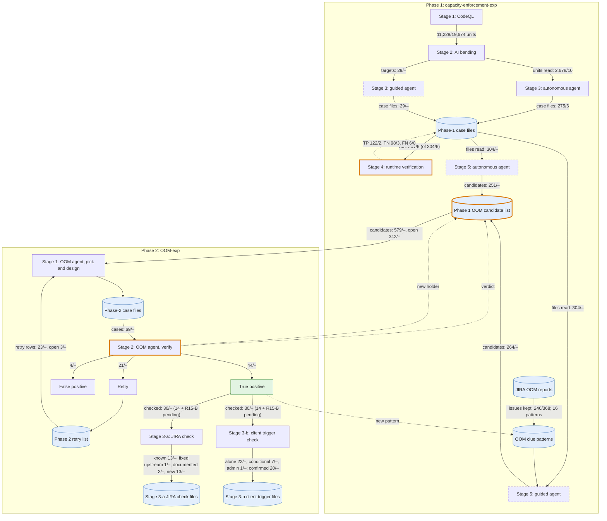

# Experiments — functionality and flowchart

*Written 2026-11-17; redesigned the same day (owner).* What `capacity-enforcement-exp` (phase 1) and
`OOM-exp` (phase 2) do and how they hand work to each other, with one flowchart. The method of each step
stays in the file each row points to; this page is the map. In prose: [`README.md`](README.md).

> **Rule ([`CLAUDE.md`](CLAUDE.md), 2026-11-17, widened 2026-11-23):** whenever a commit under `experiments/` changes
> the design (a step, agent, playbook, list, vocabulary or hand-off) **or a result number** of either experiment, update
> this page in the same commit: tables and chart plus a change-log line for design; arrow labels and §5.1 for numbers.

## 1. The two experiments

**Phase 1, [`capacity-enforcement-exp/`](capacity-enforcement-exp/README.md)** (Targets 1 + 2; Cassandra
5.0.9, Hadoop 3.4.2). It finds the **resource constraints** that are supposed to cap a node's memory or
disk and checks whether usage follows each one (stages 1–4), then reads every filed case for **clues that
could lead to OOM** and writes them as **OOM candidates** (stage 5).
[`entry-restriction-exp/`](entry-restriction-exp/README.md) is a paused phase-1 supplement.

**Phase 2, [`OOM-exp/`](OOM-exp/README.md)** (Target 3; Cassandra so far). An **OOM agent** picks
candidates (and earlier cases worth a retry), writes a case file with a design that should lead to OOM
(stage 1), then a fresh OOM-agent session runs that design and concludes **true positive**, **false
positive** or **retry** (stage 2). Every true positive is then checked read-only against Apache JIRA (stage 3-a) and
for whether an ordinary client could trigger it (stage 3-b).
Only default constraints are considered (rule 2026-11-23).

## 2. Phase 1 — functionality

| Step | What it does | Where |
|---|---|---|
| Stage 1 — CodeQL | Narrows `if` statements structurally to a worklist (no keyword list) | [`stage1-codeql-preprocessing/`](capacity-enforcement-exp/stage1-codeql-preprocessing/README.md) |
| Stage 2 — AI banding | Ranks rows A/B/C/D by name only; rules nothing out | [`stage2-ai-preprocessing/`](capacity-enforcement-exp/stage2-ai-preprocessing/README.md) |
| Stage 3 — autonomous agent | Target only, isolated source copy: traces the constraint, estimates, designs unit + cluster tiers (a non-config variant skips config-type constraints) | [`playbook-autonomous.md`](capacity-enforcement-exp/stage3-ai-deep-read/playbook-autonomous.md), [`playbook-non-config-autonomous.md`](capacity-enforcement-exp/stage3-ai-deep-read/playbook-non-config-autonomous.md) |
| Stage 3 — guided agent | Target + the three rules, enforcement patterns, test-design method | [`playbook-guided.md`](capacity-enforcement-exp/stage3-ai-deep-read/playbook-guided.md) |
| Stage 3 — verdict files | `_INDEX.md`, `predicted-negative/positive.md`, `undetermined.md` | `capacity-enforcement-exp/<system>/stage3-ai-deep-read/` |
| Stage 4 — runtime verification | Design audit, frozen predictions, runs, verdict, outcome class (TP / FP / TN / FN / undetermined); feedback amends the case file | [`stage4-runtime-verification/`](capacity-enforcement-exp/stage4-runtime-verification/README.md) |
| JIRA OOM report | Per system: analysis of the project's JIRA OOM reports (cause patterns, by-design closures); read only | [`jira-mining.md`](capacity-enforcement-exp/stage5-oom-clue-find/jira-mining.md), `<system>/stage5-oom-clue-find/jira-oom-report.md` |
| OOM clue patterns | System-agnostic `CP-<n>` patterns from the JIRA reports and phase-2 true positives | [`oom-clue-patterns.md`](capacity-enforcement-exp/stage5-oom-clue-find/oom-clue-patterns.md) |
| Stage 5 — autonomous agent | Reads one case file (+ stage-4 results), finds clues in its own words; never sees patterns, JIRA or phase 2 | [stage-5 `playbook-autonomous.md`](capacity-enforcement-exp/stage5-oom-clue-find/playbook-autonomous.md) |
| Stage 5 — guided agent | The same, checking each OOM clue pattern | [stage-5 `playbook-guided.md`](capacity-enforcement-exp/stage5-oom-clue-find/playbook-guided.md) |
| Phase 1 OOM candidate list | One row per candidate (`OC-<n>`), agent, patterns, Status written back by phase 2; plus `coverage.csv` | `<system>/stage5-oom-clue-find/phase1-oom-candidates.md` |

## 3. Phase 2 — functionality

| Step | What it does | Where |
|---|---|---|
| Stage 1 — pick and design (OOM agent) | Picks from the candidate list and the retry list (JIRA prior-art check, skips recorded); writes the case file: the phase-1 case file, a frozen design solution, conclusion `pending` | [`oom-agent-playbook.md`](OOM-exp/oom-agent-playbook.md), [`_TEMPLATE-case.md`](OOM-exp/_TEMPLATE-case.md) |
| Technique notes | Convergence (custom / default), combo, bypass: shapes for a design | [`custom-convergence`](OOM-exp/custom-convergence-playbook.md), [`default-convergence`](OOM-exp/default-convergence-playbook.md), [`combo`](OOM-exp/combo-playbook.md), [`bypass`](OOM-exp/bypass-playbook.md) |
| Stage 2 — verify (fresh OOM agent) | Runs the frozen design, records harness and runs, adds the conclusion | oom-agent playbook, [`verification-protocol.md`](OOM-exp/verification-protocol.md) |
| Verdict | **true positive** (OOM, V1–V7 met) / **false positive** (a valid design cannot reach OOM, or OOM only with a non-default constraint) / **retry** | oom-agent playbook "False positive or retry" |
| Scope rule (2026-11-23) | Default constraints only: stage 1 skips a candidate that needs a non-default constraint; budgets follow V7; control/intervention arms may change one | [`verification-protocol.md`](OOM-exp/verification-protocol.md) "Default constraints only" |
| Stage 3-a — JIRA check (fresh session, 2026-11-23) | Each true positive checked read-only against Apache JIRA: match level, issue state, fix in the pinned version, documented source; one label per case | oom-agent playbook, `OOM-exp/<system>/stage3-jira-check/` |
| Stage 3-b — client trigger check (fresh session, 2026-11-23) | Each true positive checked against a client threat model (authenticated non-admin user, native protocol only): lowest privilege, conditions outside the client's control, blast radius; optional confirm runs | oom-agent playbook, `OOM-exp/<system>/stage3b-client-trigger/` |
| Phase 2 retry list | Cases worth another try, with what a better design should change | `OOM-exp/<system>/phase2-retry-list.md` |
| Case index | Every case with its verdict, phase-1 case file, stage 3-a JIRA label and stage 3-b client label | [`OOM-exp/cassandra/cases/_INDEX.md`](OOM-exp/cassandra/cases/_INDEX.md) |

## 4. Links between the experiments

| Link | Direction | Where |
|---|---|---|
| Stage 5 writes OOM candidates; the OOM agent picks from them | phase 1 → 2 | candidate list |
| Stage 2 writes each candidate's verdict back (per-agent true-positive rate) | phase 2 → 1 | candidate list Status |
| A true positive whose shape no pattern covers becomes a new clue pattern | phase 2 → 1 | `oom-clue-patterns.md` |
| A new holder a stage-2 run revealed but did not claim becomes a candidate row (owner-approved, Agent `phase-2 (<ID>)`) | phase 2 → 1 | candidate list |
| Each phase-2 case names its phase-1 case file | phase 2 → 1 | case file §1, `_INDEX.md` |

## 5. Flowchart

Step names only; what each step does is in sections 2–4. Arrow labels carry the **current numbers** as
**Cassandra/Hadoop** (for example `275/6`), as of 2026-11-23; **–** = not started for that system. The full breakdown
with sources is in 5.1. **Node markers** (open work, details in 5.2): **orange border** = work at this step waits on an
owner decision; **dashed border** = not started for Hadoop (phase 2 is Cassandra only and is not marked). Solid arrows: the main path. Dotted arrows:
write-back and feedback. Cylinders: lists and files that one step writes and another reads.

Notes on the chart:

- **Stage 5 never chases a clue** and phase-1 agents never read phase-2 results; the only phase-2 signal
  that reaches phase 1 is a new clue pattern, which only the guided agent reads.
- **Hadoop** has run phase 1 stages 1–4 (stage 3 and 4 on a first batch) and its JIRA OOM report; its stage 5
  and phase 2 are not started.

### 5.1 Results snapshot (as of 2026-11-23)

Each step is written as **in = out + … + left**, Cassandra and Hadoop separately, and every sum closes. Counts are
recomputed from the data files named (where a README or handoff states an older count, the data file wins); refreshed
in the same commit as any result change (rule in [`CLAUDE.md`](CLAUDE.md)). Paths are under
`capacity-enforcement-exp/` unless they start with `OOM-exp/` or `codeql-queries/`.

#### Phase 1 — `capacity-enforcement-exp`

**Stage 1, CodeQL: result rows → units** (`codeql-queries/results/<sys>/`, gitignored; unit ids from
`codeql-queries/scripts/make-stage2-batches.py`). Narrowed rows are one unit each; helper-guarded rows collapse to one
unit per helper; enforcement rows to one per comparison/call key, verdict rows to one per verdict method; capacity-set
rows are one unit each.

| Query | Cassandra rows → units | Hadoop rows → units |
|---|---|---|
| NarrowedIfStatements | 4,489 → 4,489 | 9,269 → 9,269 |
| HelperGuardedIfStatements | 1,099 → 300 | 1,573 → 415 |
| EnforcementPlaces, comparison or call | 4,212 → 3,482 | 4,481 → 3,677 |
| EnforcementPlaces, verdict | 1,340 → 465 | 2,251 → 1,194 |
| CapacitySetPlaces | 2,492 → 2,492 | 5,119 → 5,119 |
| **Total** (`if` corpus + extension) | **13,632 → 11,228** (4,789 + 6,439) | **22,693 → 19,674** (9,684 + 9,990) |

**Stage 2, banding** (`<sys>/stage2-ai-preprocessing/bands.csv`): units = A + B + C + D.

| | A | B | C | D | Units |
|---|---|---|---|---|---|
| Cassandra `if` corpus / extension | 134 / 90 | 174 / 124 | 94 / 307 | 4,387 / 5,918 | 4,789 / 6,439 |
| **Cassandra** | 224 | 298 | 401 | 10,305 | **11,228** |
| Hadoop `if` corpus / extension | 90 / 110 | 170 / 272 | 489 / 615 | 8,935 / 8,993 | 9,684 / 9,990 |
| **Hadoop** | 200 | 442 | 1,104 | 17,928 | **19,674** |

**Stage 3, deep read — units** (Cassandra: `cassandra/stage3-ai-deep-read/` set CSVs, band-D progress CSVs,
`band-d-noncfg-processed.md`; Hadoop: `hadoop/status.py`, the two `queue.csv`).

- **Cassandra: 11,228 = read 2,678 + already a case target, not re-read 13 + queued, not read 2,619 + not queued 5,918.**
  - read 2,678 = `if` A–C 402 (pre-existing targets 65, set A 168, set B 169) + band-D set B 2,193 + band-D set A helpers
    30 + extension orders 1–53 53;
  - read 2,678 = became a case target **353** (65 + 163 + 27 + 88 + 10) + judged not a case **2,325** (set A config-type skips
    5, set B judged without write-up 169, band-D helpers 3, band-D set B refused 2,105, extension covered 43);
  - not re-read 13 = 6 extension anchors (not in `writeup-set-ext.csv`) + 7 extension rows already a case target;
  - queued, not read 2,619 = band-D set A 2,164 + extension A–C 455; not queued = extension band D 5,918.
- **Hadoop: 19,674 = read 10 + queued, not read 10,671 (Yang 8,930, Jingsong 1,741) + not queued 8,993** (extension band D).
  Read 10 = became a case 6 + not a case 4 (Yang's rechecks that stayed in band D).

**Stage 3 — case files** (`<sys>/stage3-ai-deep-read/_INDEX.md` §1; §2's "58" is stale).

| Cassandra source | Files | Guided | Positive / negative / undetermined |
|---|---|---|---|
| Before the two-set job (2026-10-22) | 58 | 29 | 42 / 16 / 0 |
| Set A, autonomous write-ups | 125 | 0 | 22 / 103 / 0 |
| Set A, non-config agent | 27 | 0 | 13 / 14 / 0 |
| Band-D set A helpers, non-config job | 27 | 0 | 0 / 27 / 0 |
| Band-D set B, advisor run | 57 | 0 | 50 / 0 / 7 |
| Extension, band A batch 1 | 10 | 0 | 10 / 0 / 0 |
| **Total** | **304** (autonomous 275 + guided 29) | **29** | **137 / 160 / 7** |

Hadoop: **6** case files = autonomous 6 = positive 3 + negative 3 (Yang 1, Jingsong 5).

**Stage 4, runtime verification** (`_INDEX.md` outcome column, `stage4-runtime-verification/results/`).

- **Cassandra: 304 = run 261 + not run 43.**
  - run 261 = TP 122 + FP 0 + TN 98 + FN 6 + undetermined 16 + weak 19 (TP 6, TN 12, FN 1);
  - not run 43 = `none`-type cases awaiting the owner's decision 29 + cases with a constraint type but no stage-4 run
    recorded 14.
- **Hadoop: 6 = run 6** = TP 2 + TN 3 + undetermined 1.

**JIRA OOM report** (`<sys>/stage5-oom-clue-find/jira-oom-survey.csv`).

- **Cassandra: 604 = kept 246 + excluded 358**; kept 246 = Fixed 120 + open 45 + by design or invalid 45 + duplicate or
  cannot reproduce 36.
- **Hadoop: 961 = kept 368 + excluded 593**; kept 368 = Fixed 201 + unresolved 97 + by design or invalid 35 + duplicate or
  cannot reproduce 35.

**OOM clue patterns** (`stage5-oom-clue-find/oom-clue-patterns.md`): **16** = from Cassandra's report only 13 (CP-1–7,
9–14) + from Hadoop's only 2 (CP-15, CP-16) + from both 1 (CP-8) + added by phase 2 0.

**Stage 5, clue find** (`<sys>/stage5-oom-clue-find/coverage.csv`, `phase1-oom-candidates.md`).

- **Cassandra:** case files read 304 by each agent (coverage.csv has 609 rows = 304 + 304 + 1 placeholder row); files
  with at least one candidate: autonomous 181, guided 195.
- **Candidates 579** (OC-1–579), agent × Status:

| Agent \ Status | Open | True positive | Covered | Retry | Skipped | Total |
|---|---|---|---|---|---|---|
| Autonomous | 151 | 30 | 67 | 3 | 0 | 251 |
| Guided | 159 | 21 | 80 | 4 | 0 | 264 |
| Legacy (migrated lists) | 30 | 25 | 3 | 3 | 1 | 62 |
| Phase-2 | 2 | 0 | 0 | 0 | 0 | 2 |
| **Total** | **342** | **76** | **150** | **10** | **1** | **579** |

  Covered 150 = by a true positive 133 + by a false positive 8 + by B14, re-tested as R13 (true positive) 6 + by a retry 3.
- **Hadoop:** not started (header-only files).

#### Phase 2 — `OOM-exp` (Cassandra; Hadoop not started)

**Inputs:** candidates 579 (open 342, above). **Retry list** (`OOM-exp/cassandra/phase2-retry-list.md`): **23 rows =
closed 20 + open 3** (R19, B22, and B8, a true positive re-opened for a deployment-level OOM). Closed 20 = re-tried →
true positive 8 + re-tried → retry again 6 + re-tried → split (U6 → R15) 1 + covered by the default re-tests (R2–R4) 3 +
C3 false positive 1 + disk-paused skip 1.

**Stages 1–2, verdicts** (`OOM-exp/cassandra/cases/_INDEX.md`; verdicts matched with and without bold).

- **Index rows 74 = history rows 5 + cases 69.** History → successor: R1 → R1-V, R6 → R6-V, C1 run 3 / reopen /
  multiplicity → C1 run 4.
- **Cases 69 = true positive 44 + false positive 4 + retry 21** (R15 counted as retry: its condition A is a retry, its
  condition B a true positive).
  - true positive 44 = `deployment` 42 + `diagnostic` 2 (C1, B8);
  - false positive 4 = R6-V, C3, R9, B1;
  - retry 21 = re-tried → true positive 8 (U1 → R7, B11 → R12, B14 → R13, U5 → R14, R10 → R18, R16 → R21, R15-A → R20,
    R17 → R22) + re-tried → retry again 6 + re-tried → split 1 (U6 → R15) + covered by the default re-tests 3 (R2–R4) +
    disk-paused skip 1 + **still open 2** (R19, B22).

**Stage 3-a, JIRA check** (`OOM-exp/cassandra/stage3-jira-check/`).

- **True positives 44 = checked 30 + pending 14** (B9, B10, B12, B13, B15, C4–C8, U2–U4, R7; missed by a counting error;
  R15-B also pending).
- **Checked 30 = known-open 10 + known-fixed (not in 5.0.9) 3 (U10, B20, R21) + known-fixed (incomplete) 1 (B8) +
  documented only 3 + new 13.** Mentioned in JIRA (exact or partial match) = 13 (exact 6 + partial 7).

**Stage 3-b, client trigger** (`OOM-exp/cassandra/stage3b-client-trigger/`).

- **True positives 44 = checked 30 + pending 14** (as 3-a).
- **Checked 30 = user alone 22 + given an outside condition 7 + admin only 1** (R18).
  - alone 22 = pre-auth 1 + login role without grants 2 + data role 15 + DDL role 4;
  - outside condition 7 = a node or replica event 3 (B23, B6, B8) + an operator memory budget below the resolved one 4
    (C1, S1, U13, R1-V).
- **Confirm runs: 30 = run 23 + not run 7; run 23 = confirmed 20 + partly 3** (R13, U7, U14).

### 5.2 Open work (as of 2026-11-24)

What is left at each step, from the "+ left" terms of 5.1 and the open items in the handoffs. Numbers are
**Cassandra/Hadoop** where both apply. **Waiting on**: **owner** = a decision only the owner can make (orange border in
the chart); **queue** = ordinary work for whoever runs that queue; **node** = a broken node or environment. Refreshed with
5.1 (rule in [`CLAUDE.md`](CLAUDE.md)).

**Phase 1 — `capacity-enforcement-exp`**

| Step | What is left | Waiting on | Tracked in |
|---|---|---|---|
| Stage 1 — CodeQL | nothing; optional: numeric `switch` case labels are not matched | — | `stage1-codeql-preprocessing/README.md` |
| Stage 2 — banding | nothing | — | `bands.csv` |
| Stage 3 — deep read | queued, not read **2,619/10,671** (C: band-D set A 2,164, extension A–C 455; H: Yang 8,930, Jingsong 1,741); not queued **5,918/8,993** (extension band D); judged but not written up 169/– (set B); unresolved unit 1/–; notes backlog (stage-3 notes not applied to filed cases, `undetermined.md` §2 re-audit, `predicted-negative.md` §10 band-D lines) | **queue** (Jingsong: band-D set A, extension; Yang: set B write-ups, Hadoop queue); **owner**: whether to queue extension band D | set CSVs, `hadoop/<name>/queue.csv`, `HANDOFF.md` "Open follow-ups" |
| Stage 4 — runtime verification | not run **43/0** (29 `none`-type, 14 with no run recorded); undetermined **16/1** (rerun list in the handoff) | **owner**: the `none`-type design (29 cases); **node**: Jingsong's Hadoop stage-4 nodes `pc41`, `pc39`, `pc29` fail SSH host-key checks (a new node needs `jingsong/setup-node.sh`); **queue**: reruns | `_INDEX.md` §1, `HANDOFF.md` |
| JIRA OOM report | nothing | — | `jira-oom-report.md` |
| OOM clue patterns | nothing | — | `oom-clue-patterns.md` |
| Stage 5 — clue find | case files not yet read **0/6** (Cassandra: new stage-3 case files feed it as they come) | **queue** (Hadoop stage 5 not started) | `coverage.csv` |
| Candidate list | open **342/–**; triage lists not closed (2026-11-18 §2 "not reachable at shipped defaults", §3 "too slow / too much disk"; 2026-11-20 "covered"); B18's cluster rows still `retry (B18)` | **owner**: close the triage lists, rule on B18's rows | `phase1-oom-candidates.md`, `runs/triage-*.md` |

**Phase 2 — `OOM-exp`** (Cassandra; Hadoop not started)

| Step | What is left | Waiting on | Tracked in |
|---|---|---|---|
| Stages 1–2 — design, verify | open retries **3** (R19, B22, B8 for a deployment-level OOM); owner rulings **5** (B19 T2's form, B21 failed I-2G intervention, U13 deployment vs diagnostic, U15 "not corrupt input", B15 proposed status); optional follow-ups 4 (R21 unclaimed lead, R22 512 MiB service-loss arm, R20 2 GiB matched set, B6 status caveat) | **owner**: the 5 rulings; **queue**: retries, follow-ups | `cassandra/phase2-retry-list.md`, `cases/_INDEX.md`, `HANDOFF.md` waves |
| Stage 3-a — JIRA check | true positives not checked **15** (B9, B10, B12, B13, B15, C4–C8, U2–U4, R7, R15-B); not ruled: C9, R1-V labels (as filed) | **queue** | `stage3-jira-check/README.md` |
| Stage 3-b — client trigger | true positives not analysed **15** (as 3-a); confirm: U14 one more run (OOM 1 of 2), repetition across nodes (all cases), B21 ring-wide fan-out, B20/U14 cluster-wide reach; 7 cases not confirm-run (low value) | **queue** | `stage3b-client-trigger/README.md` |
| Nodes | wave-6 run folders on all 10 nodes (`/mydata/s4/<case>`, 0.6–6 GB each; heap dumps 2.2 GB on `pc75`, 2.4 GB on `pc99`) | **owner**: delete or keep | `HANDOFF.md` wave 6 |

## 6. Change log of this page

| Date | Change |
|---|---|
| 2026-11-17 | Written: both experiments, linking functionality through the 2026-11-17 rulings (agent queues rows, autonomous OOM leads, recheck sweep, back-link updates the guided agent, lead-list status, rescan claims) |
| 2026-11-17 | Flowchart reduced to step names; descriptions stay in sections 2–4 (owner) |
| 2026-11-17 | **Redesign (owner):** the 2026-11-16/17 linking machinery and phase 2's lead sources removed; phase 1 gains stage 5 (OOM clue find: JIRA OOM reports → clue patterns; autonomous and guided agents → candidate list); phase 2 becomes the OOM agent's two stages with true positive / false positive / retry and a retry list; data-flow tracing dropped |
| 2026-11-18 | Candidate list status vocabulary gains `closed: covered by <case ID> (<verdict>)` (owner); no step or arrow changed |
| 2026-11-20 | New lead source (owner): stage 2 may propose a holder its runs revealed but did not claim; with approval it becomes a candidate row with Agent `phase-2 (<case ID>)` (first: OC-578 from R12). §4 row and a dotted `new holder` arrow O2 → CL added |
| 2026-11-23 | Phase 2 gains **stage 3, JIRA check** (owner): every true positive checked read-only against Apache JIRA; new chart nodes O3 and JC; case index gains a JIRA column. Scope rule (owner): default constraints only, an OOM needing a non-default constraint is a false positive and stage 1 skips such candidates (verdict row and new scope row) |
| 2026-11-23 | Stage 3 split (owner): the JIRA check becomes **3-a**; new **3-b, client trigger check** (could an ordinary authenticated user trigger the OOM and affect other users); chart nodes O3B and CT; case index gains a Client column |
| 2026-11-23 | Stage 3-b privilege levels gain `login role, no grants` (between pre-auth and data role), from the confirm runs; no step or arrow changed |
| 2026-11-23 | Result numbers added (owner): arrow labels in the chart and a results snapshot (5.1) for both phases, refreshed with each batch's results; Hadoop note corrected (its JIRA report exists, stage 5 not started) |
| 2026-11-23 | Arrow-label format (owner): numbers written as Cassandra/Hadoop with a legend, – = not started; phase-2 counts corrected (44 true positives, not 30; stage 3 covered 30 of them) |
| 2026-11-23 | Rule widened (owner): result-number changes in either experiment also update this page in the same commit; pointers added to the root `CLAUDE.md` batch-commit step and Hadoop `PROCEDURE.md` |
| 2026-11-23 | §5.1 rewritten as splits that close (owner): each step as in = out + … + left, per system; corrections: phase-2 cases 69, open retries 2, Cassandra units read 2,678, pattern origins 13 + 2 + 1 |
| 2026-11-24 | Open work shown (owner): new §5.2 (what is left per step, waiting on owner / queue / node) and node markers in the chart (orange border = waits on an owner decision; dashed = not started for Hadoop) |
