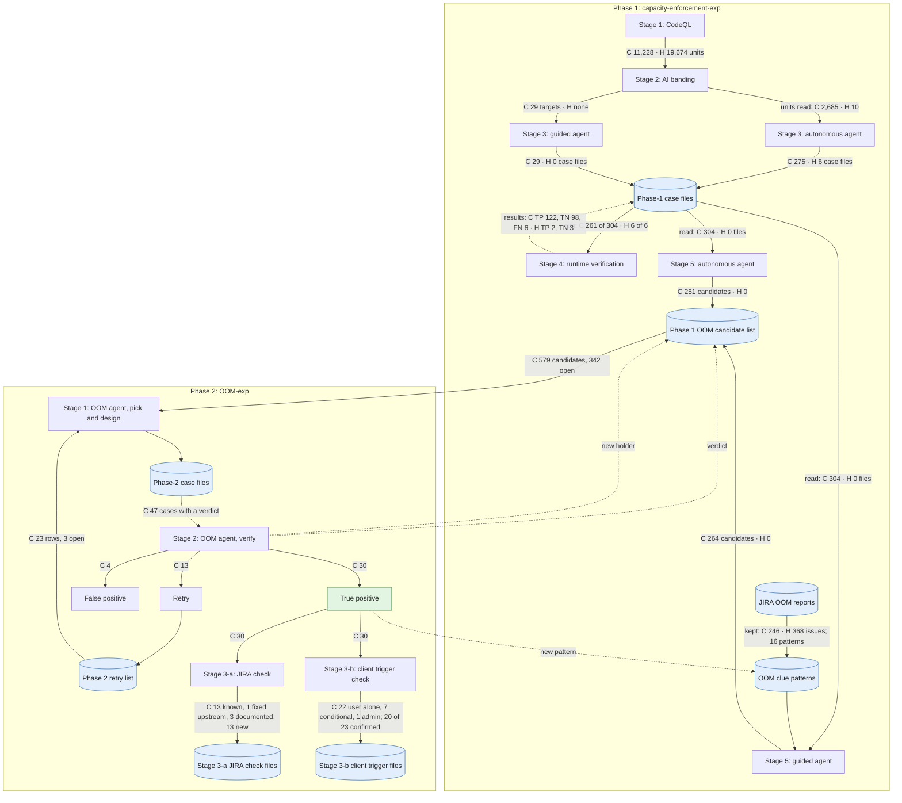

# Experiments — functionality and flowchart

*Written 2026-11-17; redesigned the same day (owner).* What `capacity-enforcement-exp` (phase 1) and
`OOM-exp` (phase 2) do and how they hand work to each other, with one flowchart. The method of each step
stays in the file each row points to; this page is the map. In prose: [`README.md`](README.md).

> **Rule ([`CLAUDE.md`](CLAUDE.md), 2026-11-17):** whenever a change under `experiments/` adds, removes,
> renames or reroutes a step, an agent, a playbook, a list or a hand-off between experiments, update this
> page (tables and flowchart) in the same commit, and add a line to the change log at the end.

## 1. The two experiments

**Phase 1, [`capacity-enforcement-exp/`](capacity-enforcement-exp/README.md)** (Targets 1 + 2; Cassandra
5.0.9, Hadoop 3.4.2). It finds the **resource constraints** that are supposed to cap a node's memory or
disk and checks whether usage follows each one (stages 1–4), then reads every filed case for **clues that
could lead to OOM** and writes them as **OOM candidates** (stage 5).
[`entry-restriction-exp/`](entry-restriction-exp/README.md) is a paused phase-1 supplement.

**Phase 2, [`OOM-exp/`](OOM-exp/README.md)** (Target 3; Cassandra so far). An **OOM agent** picks
candidates (and earlier cases worth a retry), writes a case file with a design that should lead to OOM
(stage 1), then a fresh OOM-agent session runs that design and concludes **true positive**, **false
positive** or **retry** (stage 2). Every true positive is then checked read-only against Apache JIRA (stage 3-a) and
for whether an ordinary client could trigger it (stage 3-b).
Only default constraints are considered (rule 2026-11-23).

## 2. Phase 1 — functionality

| Step | What it does | Where |
|---|---|---|
| Stage 1 — CodeQL | Narrows `if` statements structurally to a worklist (no keyword list) | [`stage1-codeql-preprocessing/`](capacity-enforcement-exp/stage1-codeql-preprocessing/README.md) |
| Stage 2 — AI banding | Ranks rows A/B/C/D by name only; rules nothing out | [`stage2-ai-preprocessing/`](capacity-enforcement-exp/stage2-ai-preprocessing/README.md) |
| Stage 3 — autonomous agent | Target only, isolated source copy: traces the constraint, estimates, designs unit + cluster tiers (a non-config variant skips config-type constraints) | [`playbook-autonomous.md`](capacity-enforcement-exp/stage3-ai-deep-read/playbook-autonomous.md), [`playbook-non-config-autonomous.md`](capacity-enforcement-exp/stage3-ai-deep-read/playbook-non-config-autonomous.md) |
| Stage 3 — guided agent | Target + the three rules, enforcement patterns, test-design method | [`playbook-guided.md`](capacity-enforcement-exp/stage3-ai-deep-read/playbook-guided.md) |
| Stage 3 — verdict files | `_INDEX.md`, `predicted-negative/positive.md`, `undetermined.md` | `capacity-enforcement-exp/<system>/stage3-ai-deep-read/` |
| Stage 4 — runtime verification | Design audit, frozen predictions, runs, verdict, outcome class (TP / FP / TN / FN / undetermined); feedback amends the case file | [`stage4-runtime-verification/`](capacity-enforcement-exp/stage4-runtime-verification/README.md) |
| JIRA OOM report | Per system: analysis of the project's JIRA OOM reports (cause patterns, by-design closures); read only | [`jira-mining.md`](capacity-enforcement-exp/stage5-oom-clue-find/jira-mining.md), `<system>/stage5-oom-clue-find/jira-oom-report.md` |
| OOM clue patterns | System-agnostic `CP-<n>` patterns from the JIRA reports and phase-2 true positives | [`oom-clue-patterns.md`](capacity-enforcement-exp/stage5-oom-clue-find/oom-clue-patterns.md) |
| Stage 5 — autonomous agent | Reads one case file (+ stage-4 results), finds clues in its own words; never sees patterns, JIRA or phase 2 | [stage-5 `playbook-autonomous.md`](capacity-enforcement-exp/stage5-oom-clue-find/playbook-autonomous.md) |
| Stage 5 — guided agent | The same, checking each OOM clue pattern | [stage-5 `playbook-guided.md`](capacity-enforcement-exp/stage5-oom-clue-find/playbook-guided.md) |
| Phase 1 OOM candidate list | One row per candidate (`OC-<n>`), agent, patterns, Status written back by phase 2; plus `coverage.csv` | `<system>/stage5-oom-clue-find/phase1-oom-candidates.md` |

## 3. Phase 2 — functionality

| Step | What it does | Where |
|---|---|---|
| Stage 1 — pick and design (OOM agent) | Picks from the candidate list and the retry list (JIRA prior-art check, skips recorded); writes the case file: the phase-1 case file, a frozen design solution, conclusion `pending` | [`oom-agent-playbook.md`](OOM-exp/oom-agent-playbook.md), [`_TEMPLATE-case.md`](OOM-exp/_TEMPLATE-case.md) |
| Technique notes | Convergence (custom / default), combo, bypass: shapes for a design | [`custom-convergence`](OOM-exp/custom-convergence-playbook.md), [`default-convergence`](OOM-exp/default-convergence-playbook.md), [`combo`](OOM-exp/combo-playbook.md), [`bypass`](OOM-exp/bypass-playbook.md) |
| Stage 2 — verify (fresh OOM agent) | Runs the frozen design, records harness and runs, adds the conclusion | oom-agent playbook, [`verification-protocol.md`](OOM-exp/verification-protocol.md) |
| Verdict | **true positive** (OOM, V1–V7 met) / **false positive** (a valid design cannot reach OOM, or OOM only with a non-default constraint) / **retry** | oom-agent playbook "False positive or retry" |
| Scope rule (2026-11-23) | Default constraints only: stage 1 skips a candidate that needs a non-default constraint; budgets follow V7; control/intervention arms may change one | [`verification-protocol.md`](OOM-exp/verification-protocol.md) "Default constraints only" |
| Stage 3-a — JIRA check (fresh session, 2026-11-23) | Each true positive checked read-only against Apache JIRA: match level, issue state, fix in the pinned version, documented source; one label per case | oom-agent playbook, `OOM-exp/<system>/stage3-jira-check/` |
| Stage 3-b — client trigger check (fresh session, 2026-11-23) | Each true positive checked against a client threat model (authenticated non-admin user, native protocol only): lowest privilege, conditions outside the client's control, blast radius; optional confirm runs | oom-agent playbook, `OOM-exp/<system>/stage3b-client-trigger/` |
| Phase 2 retry list | Cases worth another try, with what a better design should change | `OOM-exp/<system>/phase2-retry-list.md` |
| Case index | Every case with its verdict, phase-1 case file, stage 3-a JIRA label and stage 3-b client label | [`OOM-exp/cassandra/cases/_INDEX.md`](OOM-exp/cassandra/cases/_INDEX.md) |

## 4. Links between the experiments

| Link | Direction | Where |
|---|---|---|
| Stage 5 writes OOM candidates; the OOM agent picks from them | phase 1 → 2 | candidate list |
| Stage 2 writes each candidate's verdict back (per-agent true-positive rate) | phase 2 → 1 | candidate list Status |
| A true positive whose shape no pattern covers becomes a new clue pattern | phase 2 → 1 | `oom-clue-patterns.md` |
| A new holder a stage-2 run revealed but did not claim becomes a candidate row (owner-approved, Agent `phase-2 (<ID>)`) | phase 2 → 1 | candidate list |
| Each phase-2 case names its phase-1 case file | phase 2 → 1 | case file §1, `_INDEX.md` |

## 5. Flowchart

Step names only; what each step does is in sections 2–4. Arrow labels carry the **current numbers** (C = Cassandra,
H = Hadoop; as of 2026-11-23); the full breakdown with sources is in 5.1. Solid arrows: the main path. Dotted arrows:
write-back and feedback. Cylinders: lists and files that one step writes and another reads.

Notes on the chart:

- **Stage 5 never chases a clue** and phase-1 agents never read phase-2 results; the only phase-2 signal
  that reaches phase 1 is a new clue pattern, which only the guided agent reads.
- **Hadoop** has run phase 1 stages 1–4 (stage 3 and 4 on a first batch) and its JIRA OOM report; its stage 5
  and phase 2 are not started.

### 5.1 Results snapshot (as of 2026-11-23)

Refreshed in the same commit as each batch's results (rule in [`CLAUDE.md`](CLAUDE.md)). Counts recomputed from the data
files named; where a README or handoff states an older count, the data file wins.

**Phase 1 — `capacity-enforcement-exp`**

| Step | Cassandra | Hadoop | Source |
|---|---|---|---|
| Stage 1 — CodeQL | 13,632 result rows → **11,228 units** (`if` corpus 4,789, extension 6,439) | 22,693 rows → **19,674 units** (9,684 / 9,990) | `codeql-queries/results/<sys>/` (gitignored), `bands.csv` |
| Stage 2 — AI banding | A 224 · B 298 · C 401 · D 10,305 | A 200 · B 442 · C 1,104 · D 17,928 | `<sys>/stage2-ai-preprocessing/bands.csv` |
| Stage 3 — deep read | ≈ 2,685 units read; **304 case files** (autonomous 275, guided 29): positive 137, negative 160, undetermined 7 | 10 units read; **6 case files** (autonomous): positive 3, negative 3 | `<sys>/stage3-ai-deep-read/_INDEX.md`, set CSVs, `hadoop/status.py` |
| Stage 4 — runtime verification | **261 of 304 run**: TP 122, FP 0, TN 98, FN 6, undetermined 16, weak 19 (TP 6, TN 12, FN 1); 43 not run | **6 of 6 run**: TP 2, TN 3, undetermined 1 | `_INDEX.md` outcome column, `stage4-runtime-verification/results/` |
| JIRA OOM report | 604 surveyed, **246 kept** | 961 read, **368 kept** | `<sys>/stage5-oom-clue-find/jira-oom-survey.csv` |
| OOM clue patterns | **16** (CP-1–16; 14 from Cassandra's report, 3 from Hadoop's; 0 added by phase 2) | (shared) | `stage5-oom-clue-find/oom-clue-patterns.md` |
| Stage 5 — clue find | 304 case files read by each agent; **579 candidates** (autonomous 251, guided 264, legacy 62, phase-2 2) | not started | `<sys>/stage5-oom-clue-find/coverage.csv`, `phase1-oom-candidates.md` |
| Candidate Status | open 342 · true positive 76 · closed: covered 150 · retry 10 · skipped 1 | — | `phase1-oom-candidates.md` |

**Phase 2 — `OOM-exp`** (Cassandra; Hadoop not started)

| Step | Cassandra | Source |
|---|---|---|
| Inputs | 579 candidates (342 open); retry list 23 rows (3 open: R19, B22, B8) | candidate list, `cassandra/phase2-retry-list.md` |
| Stages 1–2 — verdicts | **47 cases**: true positive **30** (28 `deployment`, 2 `diagnostic`), false positive 4, retry 13 | `OOM-exp/cassandra/cases/_INDEX.md` |
| Stage 3-a — JIRA check | of 30: **13 mentioned** (6 exact, 7 partial: 10 open, 2 fixed only after 5.0.9, 1 fixed incompletely in 5.0.9); 1 fixed upstream without an issue; 3 documented only; **13 new** | `OOM-exp/cassandra/stage3-jira-check/README.md` |
| Stage 3-b — client trigger | of 30: **22 by a user alone** (pre-auth 1, login without grants 2, data role 15, DDL role 4); 7 given an outside condition; 1 admin only. Confirm runs: 23 run, **20 confirmed, 3 partly** | `OOM-exp/cassandra/stage3b-client-trigger/README.md` |

## 6. Change log of this page

| Date | Change |
|---|---|
| 2026-11-17 | Written: both experiments, linking functionality through the 2026-11-17 rulings (agent queues rows, autonomous OOM leads, recheck sweep, back-link updates the guided agent, lead-list status, rescan claims) |
| 2026-11-17 | Flowchart reduced to step names; descriptions stay in sections 2–4 (owner) |
| 2026-11-17 | **Redesign (owner):** the 2026-11-16/17 linking machinery and phase 2's lead sources removed; phase 1 gains stage 5 (OOM clue find: JIRA OOM reports → clue patterns; autonomous and guided agents → candidate list); phase 2 becomes the OOM agent's two stages with true positive / false positive / retry and a retry list; data-flow tracing dropped |
| 2026-11-18 | Candidate list status vocabulary gains `closed: covered by <case ID> (<verdict>)` (owner); no step or arrow changed |
| 2026-11-20 | New lead source (owner): stage 2 may propose a holder its runs revealed but did not claim; with approval it becomes a candidate row with Agent `phase-2 (<case ID>)` (first: OC-578 from R12). §4 row and a dotted `new holder` arrow O2 → CL added |
| 2026-11-23 | Phase 2 gains **stage 3, JIRA check** (owner): every true positive checked read-only against Apache JIRA; new chart nodes O3 and JC; case index gains a JIRA column. Scope rule (owner): default constraints only, an OOM needing a non-default constraint is a false positive and stage 1 skips such candidates (verdict row and new scope row) |
| 2026-11-23 | Stage 3 split (owner): the JIRA check becomes **3-a**; new **3-b, client trigger check** (could an ordinary authenticated user trigger the OOM and affect other users); chart nodes O3B and CT; case index gains a Client column |
| 2026-11-23 | Stage 3-b privilege levels gain `login role, no grants` (between pre-auth and data role), from the confirm runs; no step or arrow changed |
| 2026-11-23 | Result numbers added (owner): arrow labels in the chart and a results snapshot (5.1) for both phases, refreshed with each batch's results; Hadoop note corrected (its JIRA report exists, stage 5 not started) |
