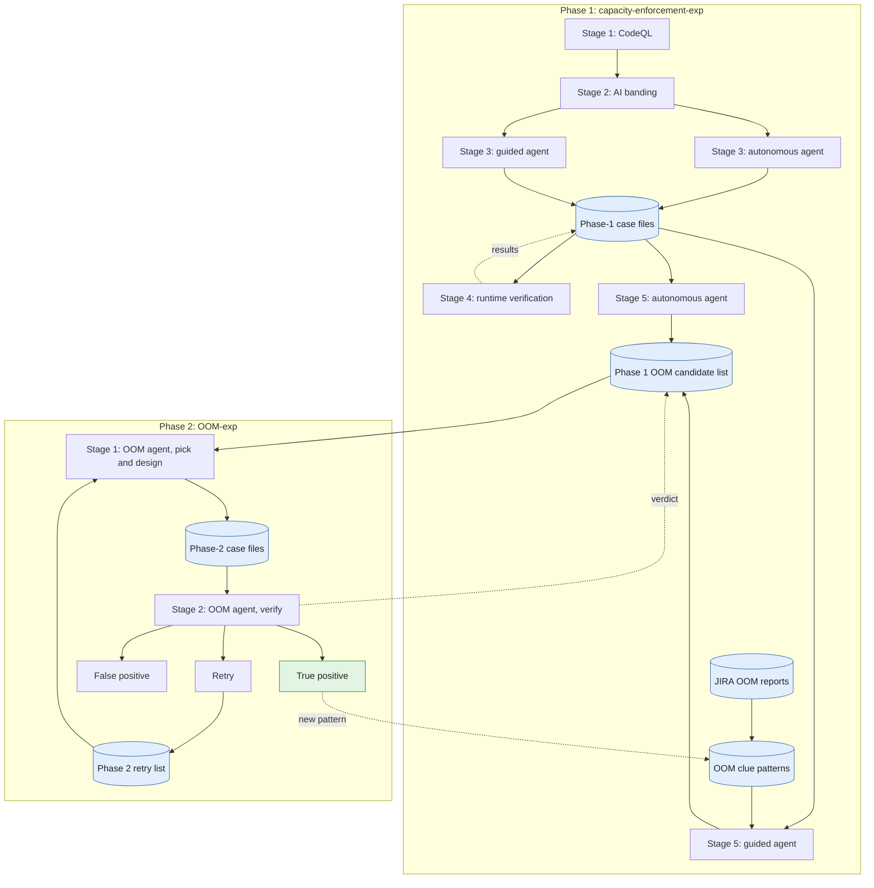

# Experiments — functionality and flowchart

*Written 2026-11-17; redesigned the same day (owner).* What `capacity-enforcement-exp` (phase 1) and
`OOM-exp` (phase 2) do and how they hand work to each other, with one flowchart. The method of each step
stays in the file each row points to; this page is the map. In prose: [`README.md`](README.md).

> **Rule ([`CLAUDE.md`](CLAUDE.md), 2026-11-17):** whenever a change under `experiments/` adds, removes,
> renames or reroutes a step, an agent, a playbook, a list or a hand-off between experiments, update this
> page (tables and flowchart) in the same commit, and add a line to the change log at the end.

## 1. The two experiments

**Phase 1, [`capacity-enforcement-exp/`](capacity-enforcement-exp/README.md)** (Targets 1 + 2; Cassandra
5.0.9, Hadoop 3.4.2). It finds the **resource constraints** that are supposed to cap a node's memory or
disk and checks whether usage follows each one (stages 1–4), then reads every filed case for **clues that
could lead to OOM** and writes them as **OOM candidates** (stage 5).
[`entry-restriction-exp/`](entry-restriction-exp/README.md) is a paused phase-1 supplement.

**Phase 2, [`OOM-exp/`](OOM-exp/README.md)** (Target 3; Cassandra so far). An **OOM agent** picks
candidates (and earlier cases worth a retry), writes a case file with a design that should lead to OOM
(stage 1), then a fresh OOM-agent session runs that design and concludes **true positive**, **false
positive** or **retry** (stage 2).

## 2. Phase 1 — functionality

| Step | What it does | Where |
|---|---|---|
| Stage 1 — CodeQL | Narrows `if` statements structurally to a worklist (no keyword list) | [`stage1-codeql-preprocessing/`](capacity-enforcement-exp/stage1-codeql-preprocessing/README.md) |
| Stage 2 — AI banding | Ranks rows A/B/C/D by name only; rules nothing out | [`stage2-ai-preprocessing/`](capacity-enforcement-exp/stage2-ai-preprocessing/README.md) |
| Stage 3 — autonomous agent | Target only, isolated source copy: traces the constraint, estimates, designs unit + cluster tiers (a non-config variant skips config-type constraints) | [`playbook-autonomous.md`](capacity-enforcement-exp/stage3-ai-deep-read/playbook-autonomous.md), [`playbook-non-config-autonomous.md`](capacity-enforcement-exp/stage3-ai-deep-read/playbook-non-config-autonomous.md) |
| Stage 3 — guided agent | Target + the three rules, enforcement patterns, test-design method | [`playbook-guided.md`](capacity-enforcement-exp/stage3-ai-deep-read/playbook-guided.md) |
| Stage 3 — verdict files | `_INDEX.md`, `predicted-negative/positive.md`, `undetermined.md` | `capacity-enforcement-exp/<system>/stage3-ai-deep-read/` |
| Stage 4 — runtime verification | Design audit, frozen predictions, runs, verdict, outcome class (TP / FP / TN / FN / undetermined); feedback amends the case file | [`stage4-runtime-verification/`](capacity-enforcement-exp/stage4-runtime-verification/README.md) |
| JIRA OOM report | Per system: analysis of the project's JIRA OOM reports (cause patterns, by-design closures); read only | [`jira-mining.md`](capacity-enforcement-exp/stage5-oom-clue-find/jira-mining.md), `<system>/stage5-oom-clue-find/jira-oom-report.md` |
| OOM clue patterns | System-agnostic `CP-<n>` patterns from the JIRA reports and phase-2 true positives | [`oom-clue-patterns.md`](capacity-enforcement-exp/stage5-oom-clue-find/oom-clue-patterns.md) |
| Stage 5 — autonomous agent | Reads one case file (+ stage-4 results), finds clues in its own words; never sees patterns, JIRA or phase 2 | [stage-5 `playbook-autonomous.md`](capacity-enforcement-exp/stage5-oom-clue-find/playbook-autonomous.md) |
| Stage 5 — guided agent | The same, checking each OOM clue pattern | [stage-5 `playbook-guided.md`](capacity-enforcement-exp/stage5-oom-clue-find/playbook-guided.md) |
| Phase 1 OOM candidate list | One row per candidate (`OC-<n>`), agent, patterns, Status written back by phase 2; plus `coverage.csv` | `<system>/stage5-oom-clue-find/phase1-oom-candidates.md` |

## 3. Phase 2 — functionality

| Step | What it does | Where |
|---|---|---|
| Stage 1 — pick and design (OOM agent) | Picks from the candidate list and the retry list (JIRA prior-art check, skips recorded); writes the case file: the phase-1 case file, a frozen design solution, conclusion `pending` | [`oom-agent-playbook.md`](OOM-exp/oom-agent-playbook.md), [`_TEMPLATE-case.md`](OOM-exp/_TEMPLATE-case.md) |
| Technique notes | Convergence (custom / default), combo, bypass: shapes for a design | [`custom-convergence`](OOM-exp/custom-convergence-playbook.md), [`default-convergence`](OOM-exp/default-convergence-playbook.md), [`combo`](OOM-exp/combo-playbook.md), [`bypass`](OOM-exp/bypass-playbook.md) |
| Stage 2 — verify (fresh OOM agent) | Runs the frozen design, records harness and runs, adds the conclusion | oom-agent playbook, [`verification-protocol.md`](OOM-exp/verification-protocol.md) |
| Verdict | **true positive** (OOM, V1–V7 met) / **false positive** (a valid design cannot reach OOM) / **retry** | oom-agent playbook "False positive or retry" |
| Phase 2 retry list | Cases worth another try, with what a better design should change | `OOM-exp/<system>/phase2-retry-list.md` |
| Case index | Every case with its verdict and phase-1 case file | [`OOM-exp/cassandra/cases/_INDEX.md`](OOM-exp/cassandra/cases/_INDEX.md) |

## 4. Links between the experiments

| Link | Direction | Where |
|---|---|---|
| Stage 5 writes OOM candidates; the OOM agent picks from them | phase 1 → 2 | candidate list |
| Stage 2 writes each candidate's verdict back (per-agent true-positive rate) | phase 2 → 1 | candidate list Status |
| A true positive whose shape no pattern covers becomes a new clue pattern | phase 2 → 1 | `oom-clue-patterns.md` |
| Each phase-2 case names its phase-1 case file | phase 2 → 1 | case file §1, `_INDEX.md` |

## 5. Flowchart

Step names only; what each step does is in sections 2–4. Solid arrows: the main path. Dotted arrows:
write-back and feedback. Cylinders: lists and files that one step writes and another reads.

Notes on the chart:

- **Stage 5 never chases a clue** and phase-1 agents never read phase-2 results; the only phase-2 signal
  that reaches phase 1 is a new clue pattern, which only the guided agent reads.
- **Hadoop** runs phase 1 stages 3–5; its JIRA OOM report and phase 2 are not started.

## 6. Change log of this page

| Date | Change |
|---|---|
| 2026-11-17 | Written: both experiments, linking functionality through the 2026-11-17 rulings (agent queues rows, autonomous OOM leads, recheck sweep, back-link updates the guided agent, lead-list status, rescan claims) |
| 2026-11-17 | Flowchart reduced to step names; descriptions stay in sections 2–4 (owner) |
| 2026-11-17 | **Redesign (owner):** the 2026-11-16/17 linking machinery and phase 2's lead sources removed; phase 1 gains stage 5 (OOM clue find: JIRA OOM reports → clue patterns; autonomous and guided agents → candidate list); phase 2 becomes the OOM agent's two stages with true positive / false positive / retry and a retry list; data-flow tracing dropped |
